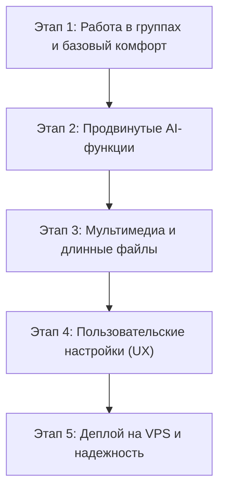

# Дорожная карта развития бота Wisperbor 🚀

В текущей версии бот уже отлично справляется с базовой задачей: мгновенно расшифровывает голосовые сообщения и видео-кружочки через **Whisper Large V3 Turbo**, делает саммари через LLM и уважает приватность пользователей.

Ниже представлена пошаговая дорожная карта (Roadmap) по превращению проекта в полноценный многофункциональный инструмент.

---

---

## 📍 Этап 1: Работа в групповых чатах и защита от спама (Quick Wins)

Самый частый сценарий использования ботов-расшифровщиков — **рабочие и учебные группы в Telegram**, где участники не любят слушать длинные войсы.

1. **Режим работы в группах**:
   - Возможность добавить бота в групповой чат как участника или администратора.
   - Автоматическая расшифровка голосовых и кружочков прямо в ветку беседы с ответом (reply) на оригинальное сообщение.
   - Игнорирование текстовых сообщений, чтобы не спамить в чате.
2. **Защита от спама (Throttling / Rate Limit)**:
   - Встроенный middleware в Aiogram для ограничения частоты запросов от одного пользователя (например, не более 1 запроса в 3 секунды).
   - Защита бесплатных лимитов API от злоупотребления.
3. **Таймкоды**:
   - Для голосовых сообщений длиннее 1 минуты вывод разбивки с таймингом: `[00:15] Вводная часть`, `[01:10] Основная мысль`.

---

## 🧠 Этап 2: Продвинутые AI-функции поверх расшифровки

Поскольку к боту уже подключены быстрые LLM через Groq, можно добавить умную обработку текста в 1 клик с помощью Inline-кнопок:

1. **Очистка от слов-паразитов**:
   - Кнопка **«✨ Очистить речь»** — убирает «э-э-э», «ну», «короче», «типа», повторяющиеся слова и заикания, оставляя идеальный литературный текст.
2. **Форматирование в деловой стиль (Email / Заметка)**:
   - Кнопка **«👔 В деловой стиль»** — превращает сумбурную надиктованную мысль в готовое структурированное письмо или задачу для Jira/Trello.
3. **Выделение задач (Action Items & To-Do)**:
   - Кнопка **«✅ Список задач»** — нейросеть сканирует расшифровку и извлекает только договоренности: *кто, что и к какому сроку должен сделать*.
4. **Мгновенный перевод**:
   - Кнопка **«🌐 Перевести»** — перевод на английский, испанский, немецкий, китайский и другие языки.

---

## 🎬 Этап 3: Поддержка внешних медиа и файлов без лимита

Сейчас бот ограничен 20 МБ (лимит стандартного Telegram Bot API на скачивание).

1. **Расшифровка видео и аудио по ссылкам**:
   - Отправка ссылки на **YouTube / YouTube Shorts / VK Клипы / TikTok**.
   - Скачивание звуковой дорожки через `yt-dlp` и расшифровка видеолекций и подкастов.
2. **Собственный локальный Telegram Bot API сервер**:
   - Позволяет поднять лимит скачивания файлов с 20 МБ до **2000 МБ (2 ГБ)**!
   - Бот сможет принимать полноценные полуторачасовые аудиозаписи диктофона и созвонов.
3. **Сжатие / нарезка длинных аудио (ffmpeg)**:
   - Автоматическая нарезка 30–60 минутных файлов на небольшие отрезки по 10 минут и склейка результата.

---

## ⚙️ Этап 4: Персональные настройки пользователя (UI / UX)

1. **Меню настроек (`/settings`) через Inline-клавиатуру**:
   - *Автовыжимка*: всегда автоматически присылать саммари вместе с текстом (Вкл / Выкл).
   - *Удаление оригинала*: удалять ли войс в группе после расшифровки.
   - *Формат отображения*: моноширинный шрифт, скрытый текст под спойлер или обычный.
2. **Режим «Тихий ответ»**:
   - Возможность присылать расшифровку тихим сообщением без звука уведомления.
3. **Интерактивный статус**:
   - Анимированный статус: `[▰▰▰▱▱] Распознавание 60%...` для длинных аудиозаписей.

---

## 🚢 Этап 5: Продакшн, деплой на сервер и мониторинг

Чтобы бот работал 24/7, не завися от вашего домашнего компьютера:

1. **Docker & Docker Compose**:
   - Создание легкого контейнера на базе Alpine Linux / Python Slim.
   - Запуск одной командой `docker compose up -d`.
2. **Размещение на недорогом облачном VPS (150–250 руб/мес)**:
   - Любой сервер на Linux (Ubuntu 22.04 / 24.04). Бот не требует GPU, так как распознавание идет в облаке Groq.
3. **Автоматический перезапуск (Systemd)**:
   - Гарантия того, что при сбое или перезагрузке сервера бот мгновенно поднимется самостоятельно.
4. **Мониторинг ошибок**:
   - Подключение бесплатного Sentry или оповещений об ошибках администратору в личку.

---

## Сводная таблица приоритетов

| Фича | Полезность | Сложность реализации | Рекомендуемый приоритет |
| :--- | :---: | :---: | :---: |
| **Работа в групповых чатах** | 🔥 Высокая | 🟢 Низкая (1–2 часа) | **Сделать первым** |
| **Кнопки: Очистка речи / Список задач** | 🔥 Высокая | 🟢 Низкая (пара промптов) | **Сделать вторым** |
| **Защита от спама (Rate Limiter)** | ⚡ Средняя | 🟢 Низкая | В комплекте с группами |
| **Docker + деплой на VPS** | 🚀 Высокая | 🟡 Средняя | Для автономной работы 24/7 |
| **Расшифровка по ссылкам (YouTube/TikTok)**| 💡 Средняя | 🟡 Средняя | По мере масштабирования |
| **Локальный Bot API (до 2 ГБ)** | 💎 Нишевая | 🔴 Высокая | При необходимости длинных лекций |
